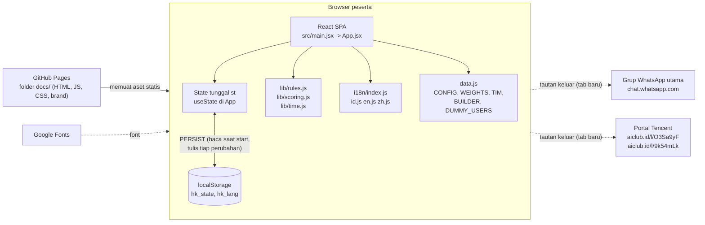
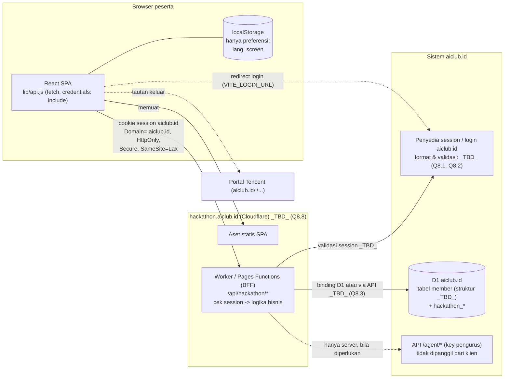
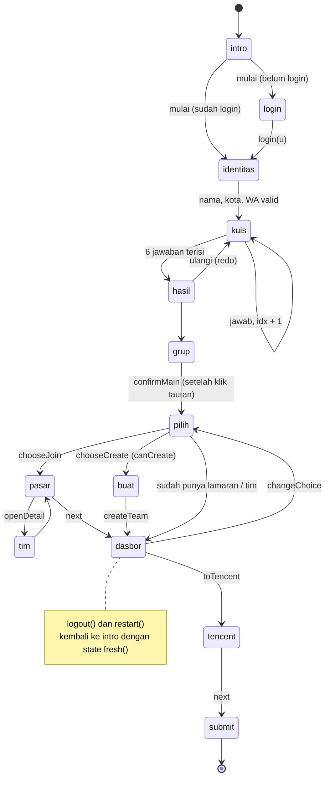
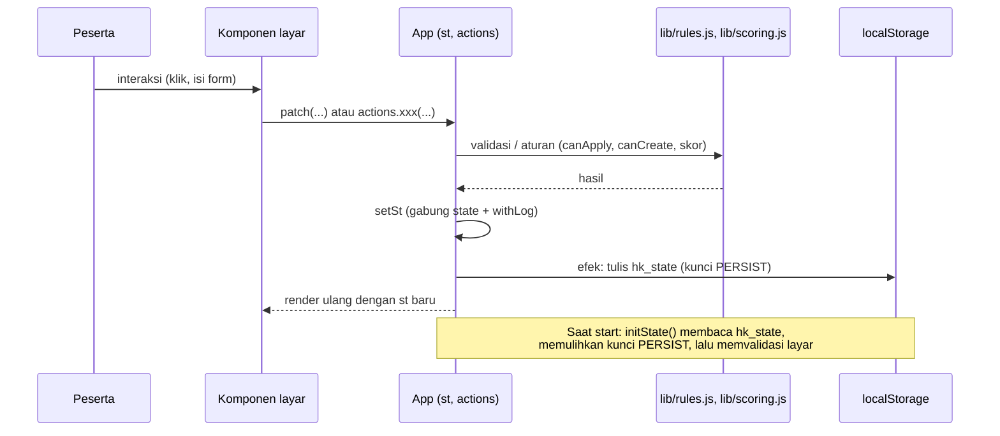
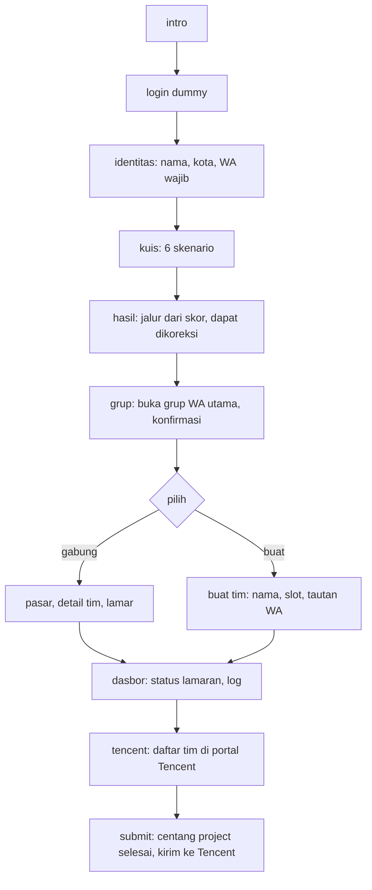
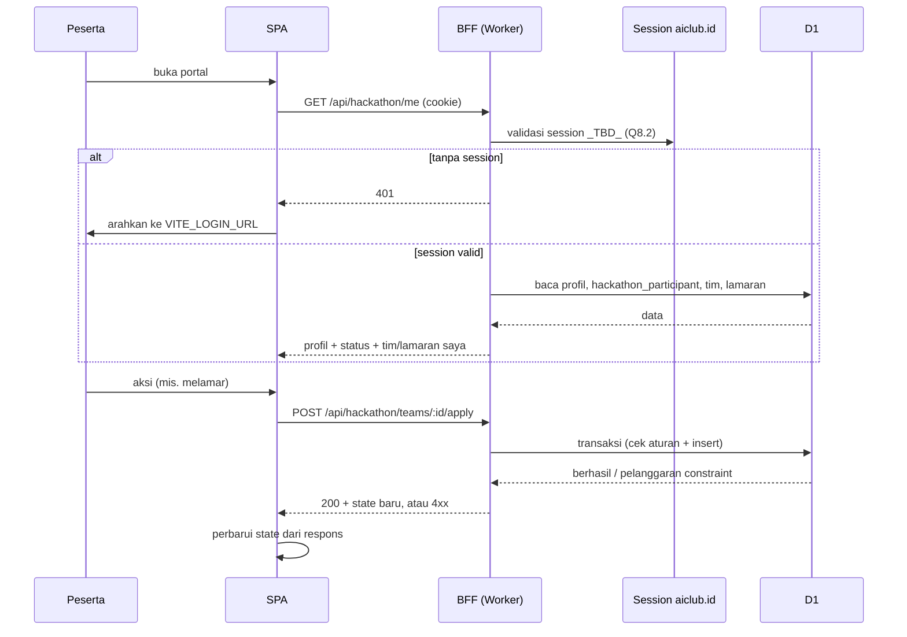
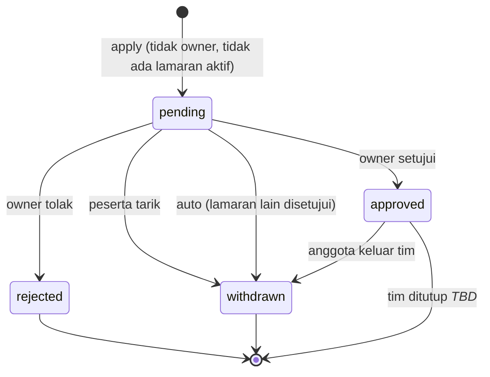
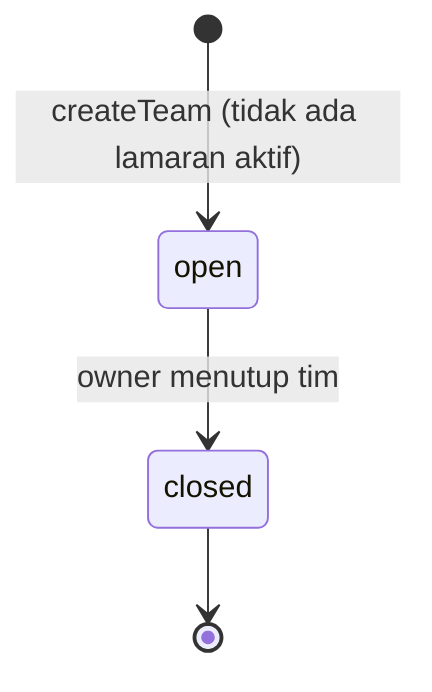

# Arsitektur Sistem

> Status: Draft
> Terakhir diperbarui: 2026-10-21
> Pemilik: Tim AIClub Hackathon

Dokumen ini menjelaskan arsitektur portal pendaftaran AI Agent Hackathon aiclub.id x Tencent Cloud: arsitektur yang berjalan sekarang (as-built), arsitektur target hasil integrasi dengan aiclub.id (rencana), komponen kode, alur data, mesin status, dan keputusan arsitektur.

Dokumen terkait: [04_TRD.md](04_TRD.md), [16_CONFIG_REFERENCE.md](16_CONFIG_REFERENCE.md), [20_DATABASE.md](20_DATABASE.md), [../brief.md](../brief.md), [../README.md](../README.md), [03_FRD.md](03_FRD.md).

Konvensi: bagian bertanda **As-built** mencerminkan kode di repositori; bagian bertanda **Rencana** bersumber dari [../brief.md](../brief.md). Fakta yang belum diketahui ditulis `_TBD_` dengan rujukan ke pertanyaan terbuka brief bagian 8 (Q8.n).

## 1. Arsitektur saat ini (As-built): SPA + localStorage

Aplikasi adalah React 18 + Vite 5 statis tanpa backend. Seluruh state berada di komponen `App` dan disalin ke `localStorage` browser.

Ciri utama:

- Tidak ada permintaan jaringan ke API aplikasi. Login, tim, pelamar, dan keputusan owner adalah data dummy di browser masing-masing, sehingga tidak dibagi antarpengguna.
- Aturan bisnis (satu orang satu tim, satu lamaran aktif) hanya dijaga di klien.
- Build keluar ke `docs/` dan disajikan GitHub Pages dari branch `main` folder `/docs`.

## 2. Arsitektur target (Rencana): SPA + BFF Cloudflare + session aiclub.id + D1

Sumber: [../brief.md](../brief.md) bagian 4. Opsi login (cookie bersama, OAuth/OIDC, atau magic link), format session, dan cara akses D1 belum diputuskan (`_TBD_`; Q8.1, Q8.2, Q8.3, Q8.8).

Prinsip (dari brief bagian 4):

1. Satu domain induk di bawah aiclub.id agar cookie session dapat dipakai bersama. GitHub Pages tidak dapat berbagi cookie dengan aiclub.id.
2. Klien tidak menyimpan kebenaran. Semua keputusan (boleh melamar, boleh melihat tautan WA, status lamaran) diputuskan server.
3. Tidak ada key pengurus di browser.

### 2.1 Perbandingan as-built dan target

| Aspek | As-built | Target (Rencana) |
|---|---|---|
| Identitas | `st.user = {email, nama}` dari form dummy atau `DUMMY_USERS` | `memberId` dari session aiclub.id |
| Sumber kebenaran | `localStorage hk_state` | D1 (tabel `hackathon_*`) |
| Daftar tim | konstanta `TIM` | `GET /api/hackathon/teams` |
| Keputusan owner | `decideApp`, `decideApplicant` mengubah state lokal | `POST /api/hackathon/applications/:id/decide` |
| Tautan WA tim | field `wa` di `TIM` (ada di bundel) | `wa_link` hanya di respons untuk owner dan pelamar `approved` |
| Aturan bisnis | `lib/rules.js` di klien | server + constraint DB (unique index parsial, transaksi) |
| Skor jalur | `skor()` di klien | klien untuk tampilan; hasil resmi dihitung ulang server |
| Hosting | GitHub Pages | subdomain aiclub.id `_TBD_` |

## 3. Komponen aplikasi (As-built)

### 3.1 Titik masuk dan struktur berkas

| Berkas | Peran |
|---|---|
| `index.html` | Cangkang HTML, meta, font Google, `
` |
| `src/main.jsx` | `createRoot(...).render(<App />)` dan impor `styles.css` |
| `src/App.jsx` | State tunggal, mesin layar, `actions`, rehidrasi, pintasan keyboard |
| `src/data.js` | Konfigurasi, konstanta, `SCREENS`, `STEP_OF`, data dummy, `ICONS` |
| `src/lib/rules.js` | Aturan lamaran dan pembuatan tim |
| `src/lib/scoring.js` | Skor jalur, validasi, kelayakan langkah |
| `src/lib/time.js` | `fmtTime` per lokal |
| `src/i18n/` | Kamus `id/en/zh` dan `makeT`, `detectLang` |
| `src/components/` | 20 berkas komponen layar dan widget |
| `src/styles.css` | CSS tunggal |
| `vite.config.js` | Konfigurasi build ke `docs/` |

### 3.2 `App.jsx`: mesin status layar

`App` menyimpan satu objek `st` (bentuknya di [20_DATABASE.md](20_DATABASE.md) bagian 2). Layar saat ini adalah `st.screen`, salah satu dari `SCREENS`:

`intro, login, identitas, kuis, hasil, grup, pilih, pasar, tim, buat, dasbor, tencent, submit`

`STEP_OF` memetakan layar ke langkah besar: `intro` dan `login` ke -1; `identitas, kuis, hasil, grup, pilih, pasar, tim, buat, dasbor` ke 0 (Daftar di portal kita); `tencent` ke 1; `submit` ke 2.

Fungsi navigasi:

- `go(screen, extra)`: mengosongkan `errors`, menggabungkan `extra` ke state, mengganti layar, dan menggulir ke atas (halus kecuali `prefers-reduced-motion`).
- `next()`: transisi maju per layar (validasi data diri di `identitas`; di `kuis` harus ada jawaban sebelum maju; `hasil` ke `grup`; `pasar` ke `dasbor`; `tencent` ke `submit`).
- `back()`: transisi mundur per layar.
- `gotoStep(i)` dan `goSub(key)`: klik langkah besar dan indikator kecil, dengan gerbang `reachable`/`subReachable`.

Gerbang kemajuan (`src/lib/scoring.js`):

| Fungsi | Syarat |
|---|---|
| `identDone(st)` | `nama` dan `kota` tidak kosong dan `waValid(wa)` (9 sampai 15 digit) |
| `quizDone(jawab)` | seluruh `total()` jawaban terisi |
| `reachable(st, step)` | `step <= 0` selalu; selain itu `identDone` dan `quizDone` dan `joinedMain` |
| `subReachable(st, key)` | `identitas` selalu; `kuis` perlu `identDone`; `hasil`/`grup` perlu `identDone` dan `quizDone`; lainnya perlu ketiganya plus `joinedMain` |

Rehidrasi `initState()` menerapkan gerbang yang sama pada layar tersimpan (lihat [04_TRD.md](04_TRD.md) TR-012).

### 3.3 `actions`

Objek `actions` di `App` dilewatkan ke komponen layar. Operasi dan efeknya:

| Aksi | Efek pada `st` | Entri log |
|---|---|---|
| `confirmMain` | `joinedMain=true`, layar `pilih`; ditolak bila `clickedMain=false` | `joinMain` |
| `toggleApply(team)` | tolak bila owner atau ada lamaran aktif ke tim lain; tarik bila `pending`; buat `{team, status:"pending", at}` bila belum ada | `apply` / `withdraw` |
| `decideApp(team, status)` | simulasi keputusan owner; bila `approved`, lamaran `pending` lain dihapus | `approved`/`rejected`, `autoWithdraw` |
| `leaveTeam(team)` | hapus lamaran tim itu, `mode=null`, ke `pilih` | `leave` |
| `withdrawAll` | hapus semua lamaran `pending` | `withdrawAll` |
| `createTeam(team)` | tolak bila `!canCreate`; set `myTeam`, `applicants` dari `SEED_APPLICANTS` (status `pending`), ke `dasbor` | `openTeam` |
| `closeTeam` | `myTeam=null`, `applicants=[]`, `undang=[]`, ke `pilih` | `closeTeam` |
| `saveTeamLink(wa)` | ubah `myTeam.wa` | tidak ada |
| `decideApplicant(i, status)` | ubah status pelamar ke tim milik sendiri | `approveWho` / `rejectWho` |
| `toggleInvite(who)` | tambah/hapus nama di `undang` | `invite` / `uninvite` |
| `openTeamGroup(tm)` | buka `tm.wa` di tab baru, atau toast bila kosong | tidak ada |
| `restart` | kembali ke `intro` dengan `fresh()` | tidak ada |

Catatan: `logout()` dan `restart()` memanggil `go("intro", fresh())` sehingga seluruh data peserta di state direset (dan `hk_state` ditimpa pada efek berikutnya).

### 3.4 `data.js`

Berisi `CONFIG`, `URUT`, `WEIGHTS`, `LATAR`, `WA_GROUP_URL`, `DUMMY_USERS`, `WA_LINK_RE`, `TIM`, `BUILDER`, `SEED_APPLICANTS`, `SCREENS`, `STEP_OF`, `TENCENT_REGISTER_URL`, `TENCENT_SUBMIT_URL`, `ICONS`. Rincian dan nilai ada di [16_CONFIG_REFERENCE.md](16_CONFIG_REFERENCE.md).

### 3.5 `lib/rules.js`

Aturan murni (tanpa efek samping) yang membaca `st`:

| Fungsi | Definisi |
|---|---|
| `approvedApp(st)` | lamaran berstatus `approved`, atau `null` |
| `pendingApps(st)` | daftar lamaran `pending` |
| `activeApp(st)` | lamaran `pending` atau `approved` pertama, atau `null` |
| `canApply(st)` | `!st.myTeam && !activeApp(st)` |
| `canCreate(st)` | `!st.myTeam` dan tidak ada lamaran `pending`/`approved` |

### 3.6 `lib/scoring.js`

| Fungsi | Peran |
|---|---|
| `total()` | `min(CONFIG.quizLen, WEIGHTS.length)` |
| `skor(jawab)` | jumlahkan bobot `WEIGHTS[i][pilihan]` ke 8 peran dalam `URUT` |
| `urutSkor(jawab)` | peran terurut menurun menurut skor (stabil menurut `URUT`) |
| `aktif(st)` | `st.override` bila ada, selain itu peran teratas |
| `quizDone`, `waValid`, `identDone`, `reachable`, `subReachable` | validasi dan gerbang kemajuan |

### 3.7 `lib/time.js` dan i18n

- `fmtTime(ms, lang)` memformat waktu log dengan lokal `id-ID`, `en-US`, `zh-CN`.
- `src/i18n/index.js` mengekspor `I18N`, `LANGS`, `detectLang()`, dan `makeT(lang)` yang menghasilkan `{t, get, role}`. `t(path, vars)` mengambil string dan menginterpolasi `{var}`; `get(path)` mengambil nilai mentah (array/objek); kunci yang tidak ada jatuh ke bahasa `id`; `role(k)` mengambil `roles.<k>`. Urutan deteksi bahasa: `?lang=`, `localStorage hk_lang`, `navigator.languages`, lalu `en`.

### 3.8 Komponen layar dan widget

| Komponen | Layar / peran | Catatan |
|---|---|---|
| `Intro.jsx` | `intro` | ajakan mulai |
| `Login.jsx` | `login` | form dummy dan daftar `DUMMY_USERS`; akan diganti tombol "Masuk dengan aiclub.id" |
| `Identity.jsx` | `identitas` | nama, kota (input teks bebas), WA, LinkedIn, email, latar (`LATAR`, lewat `Combo`) |
| `Quiz.jsx` | `kuis` | satu pertanyaan per layar, dipasangkan `key={st.idx}` |
| `Result.jsx` | `hasil` | skor, jalur utama dan kedua, koreksi lewat `override` |
| `Group.jsx` | `grup` | tautan `WA_GROUP_URL`, konfirmasi, pesan perkenalan siap bagikan (`shareText`) |
| `Choose.jsx` | `pilih` | pilih gabung atau buat tim; tampil kunci bila sudah owner/anggota |
| `Market.jsx` | `pasar` | daftar `TIM`, lamar/tarik |
| `TeamDetail.jsx` | `tim` | detail tim dan CTA sesuai status lamaran |
| `Create.jsx` | `buat` | form pembuatan tim, validasi `WA_LINK_RE` |
| `Dash.jsx` | `dasbor` | status lamaran, log aktivitas, jadwal, hadiah; menampung `MyTeam` bila owner |
| `MyTeam.jsx` | panel owner di `dasbor` | tautan grup tim, kotak pelamar masuk, undang builder, tutup tim |
| `Tencent.jsx` | `tencent` | status tim, tautan `TENCENT_REGISTER_URL` |
| `Submit.jsx` | `submit` | centang `projectReady`, tautan `TENCENT_SUBMIT_URL` |
| `Chrome.jsx` | `Header`, `Stepper`, `BottomNav` | bahasa, chip pengguna, navigasi langkah |
| `Widgets.jsx` | `ConfirmButton`, `SubSteps` | tombol dua klik (batas 4 detik), indikator 6 sub-langkah |
| `Common.jsx` | `Head`, `Actions` | kepala layar dan baris tombol |
| `Combo.jsx` | combobox pencarian | dipakai untuk pilihan latar (`Identity`) dan koreksi peran (`Result`) |
| `EventInfo.jsx` | `Prize`, `Challenges` | info event dari kamus i18n |
| `Brand.jsx` | `asset()`, `PARTNERS`, `Footer` | logo dan mitra |

Indikator kecil `SubSteps` memetakan layar ke enam posisi: Data (`identitas`), Skenario (`kuis`), Jalur (`hasil`), Grup utama (`grup`), Tim (`pilih/pasar/tim/buat`), Status (`dasbor`).

## 4. Alur data

### 4.1 As-built: siklus state

Alur lengkap peserta (As-built):

### 4.2 Rencana: siklus permintaan

## 5. Mesin status

### 5.1 Lamaran (application)

As-built (klien, `st.apps[]`): status `pending`, `approved`, `rejected`. Menarik lamaran menghapus elemen (tidak ada status `withdrawn`). Keluar dari tim (`leaveTeam`) juga menghapus elemen.

Rencana (server, `hackathon_application.status`): `pending | approved | rejected | withdrawn`.

Aturan:

- Lamaran aktif = `pending` atau `approved`; maksimal satu per orang (klien: `activeApp`; server: unique index parsial).
- Saat satu lamaran `approved`, lamaran `pending` lain milik orang itu menjadi `withdrawn` (as-built: dihapus, dicatat `autoWithdraw`).
- `rejected` tidak mengunci peserta; UI as-built tidak mengizinkan melamar ulang ke tim yang sama (`toggleApply` tidak berbuat apa pun untuk lamaran `rejected`).
- Perlakuan lamaran `approved` ketika owner menutup tim: `_TBD_` (tidak ditentukan di brief). Di as-built, `closeTeam` hanya menghapus tim milik owner di state owner; anggota tidak terpengaruh karena tidak ada backend.

### 5.2 Tim

As-built (`st.myTeam`): `null` (tidak ada tim) atau objek `{nama, desc, kota, butuh[], wa}`; menutup tim mengembalikan ke `null`.

Rencana (`hackathon_team.status`): `open | closed`.

Aturan: satu orang adalah owner satu tim atau anggota satu tim, tidak keduanya; owner hanya dapat membuat tim lain setelah menutup tim; anggota keluar dulu sebelum membuat tim (brief bagian 5.3 butir 1 dan 5).

### 5.3 Peserta (kemajuan pendaftaran)

Peserta tidak memiliki kolom status tunggal; kemajuan diturunkan dari flag.

| Tahap | Penanda (As-built) | Penanda (Rencana, `hackathon_participant`) |
|---|---|---|
| Data diri lengkap | `identDone(st)` | profil aiclub.id lengkap (`_TBD_`, Q8.4) |
| Kuis selesai | `quizDone(jawab)` | `jawaban` terisi |
| Jalur | `aktif(st)` (`override` atau skor) | `jalur`, `jalur_override` |
| Grup utama | `clickedMain`, `joinedMain` | `joined_main_at` |
| Daftar ke Tencent | `tencentClicked` | `tencent_clicked_at` |
| Project selesai | `projectReady` | `project_ready_at` |
| Submit dibuka | `submitClicked` | `submit_clicked_at` |

## 6. Keputusan arsitektur (ADR ringkas)

| ID | Keputusan | Status | Alasan | Konsekuensi |
|---|---|---|---|---|
| ADR-001 | SPA React statis tanpa backend untuk versi dummy | As-built | Cepat dibuat dan di-deploy; cukup untuk memperagakan alur | Data tidak dibagi antarpengguna; aturan bisnis dapat dilewati |
| ADR-002 | Satu objek state di `App`, tanpa library state | As-built | Aplikasi kecil, alur linear | Semua komponen menerima props; perubahan state besar bertumpu pada `App.jsx` |
| ADR-003 | Navigasi layar lewat state `screen`, tanpa router | As-built | Alur wizard linear dengan gerbang kemajuan | Tidak ada deep link; tombol Back browser tidak berpindah layar; perlu dikaji ulang untuk produksi `_TBD_` |
| ADR-004 | Persistensi `localStorage` dengan daftar kunci `PERSIST` | As-built | Progres bertahan antarmuat ulang tanpa server | Hanya per-browser; data dapat diedit manual (karena itu rehidrasi memvalidasi layar) |
| ADR-005 | i18n buatan sendiri (3 kamus, fallback ke `id`) | As-built | Tanpa dependensi, ukuran bundel kecil | Paritas kunci dijaga manual; pemeriksaan otomatis direncanakan (TR-058) |
| ADR-006 | Build ke `docs/` dengan `base: "./"`, `emptyOutDir: false` | As-built | GitHub Pages dari `/docs`; dokumentasi hidup di folder yang sama | Hasil build ikut di-commit; harus build ulang tiap rilis |
| ADR-007 | Tautan Tencent lewat short link `aiclub.id/l/...` | As-built | Portal Tencent di luar cakupan; tidak ada integrasi data | Tidak ada data balik (Q8.6) |
| ADR-008 | Konfigurasi dan data dummy di `src/data.js` | As-built | Satu tempat untuk diubah | Perlu dibersihkan saat integrasi (TR-030) |
| ADR-009 | BFF Cloudflare Worker/Pages Functions di subdomain aiclub.id | Rencana | Infrastruktur aiclub.id memakai Cloudflare (D1, R2); cookie session bersama membutuhkan domain induk | Bergantung Q8.1 sampai Q8.3 dan Q8.8 |
| ADR-010 | Server sebagai satu-satunya sumber kebenaran; klien hanya preferensi | Rencana | Aturan di klien dapat dilewati; data lintas perangkat | `PERSIST` menyusut menjadi `lang` dan `screen` (TR-014) |
| ADR-011 | Constraint DB (unique index parsial) + transaksi untuk aturan lamaran | Rencana | Mencegah race condition lamaran ganda | Lihat [20_DATABASE.md](20_DATABASE.md) |
| ADR-012 | Tanpa key pengurus di klien; BFF memakai session member atau binding D1 | Rencana | API `/agent/*` memakai key pengurus | BFF menjadi satu-satunya jalur ke data |
| ADR-013 | Skor jalur dihitung klien untuk tampilan, ulang di server untuk hasil resmi | Rencana | Tampilan responsif tanpa memercayai klien | `WEIGHTS`/`URUT` perlu identik; tes paritas (TR-027) |
| ADR-014 | Opsi login: A cookie session bersama (disarankan), B OAuth/OIDC, C magic link | Rencana, `_TBD_` | Paling sederhana dan mulus bila portal di `*.aiclub.id` | Menunggu Q8.1 dan Q8.2 |

## 7. Titik perluasan dan risiko arsitektur

- **Pemisahan lapisan data:** saat ini komponen membaca konstanta (`TIM`, `BUILDER`) dan `st` langsung. Pada integrasi, akses data dipusatkan di `src/lib/api.js` dan `App.jsx` sehingga komponen cukup menerima props (brief bagian 7 butir 6).
- **Identitas tim:** state as-built mengidentifikasi tim dan pelamar dengan nama (`apps[].team` = `TIM.nama`; `applicants[].b` = indeks `BUILDER`). Versi server memakai `id` (lihat [20_DATABASE.md](20_DATABASE.md)).
- **Risiko terbesar:** integrasi tertahan tanpa penyedia login atau akses DB dari aiclub.id (brief bagian 11).
- **Tenggat:** pendaftaran ditutup 1 Nov; fase 1 sampai 3 perlu selesai sebelumnya.
