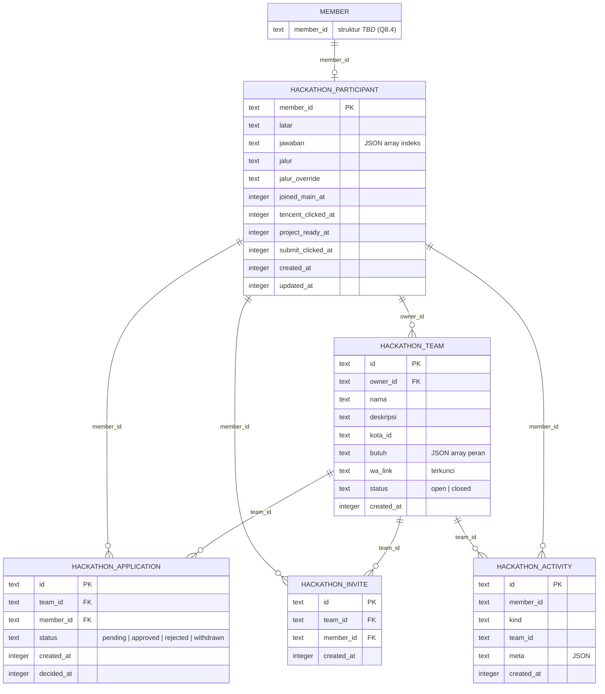

# Basis Data

> Status: Draft
> Terakhir diperbarui: 2026-10-21
> Pemilik: Tim AIClub Hackathon

Dokumen ini menjelaskan (1) kondisi data sekarang, yaitu tidak ada basis data dan seluruh data adalah state dummy di `localStorage`; dan (2) skema target `hackathon_*` pada D1 aiclub.id yang diusulkan di [../brief.md](../brief.md) bagian 5, diperinci menjadi kolom, tipe, constraint, index, relasi, aturan transaksi, contoh query, strategi migrasi, dan catatan privasi.

Dokumen terkait: [04_TRD.md](04_TRD.md), [05_ARCHITECTURE.md](05_ARCHITECTURE.md), [16_CONFIG_REFERENCE.md](16_CONFIG_REFERENCE.md), [../brief.md](../brief.md), [../README.md](../README.md).

Konvensi: bagian 1 dan 2 adalah **As-built**. Bagian 3 dan seterusnya adalah **Rencana**. Kolom dan constraint yang tertulis di brief bagian 5.2 ditandai "brief"; rincian tambahan yang berasal dari dokumen ini ditandai "usulan perincian" dan perlu disetujui. Fakta yang belum diketahui ditulis `_TBD_` dengan rujukan Q8.n ke [../brief.md](../brief.md) bagian 8. Dokumen ini tidak mengarang struktur tabel member aiclub.id.

## 1. Kondisi sekarang: tidak ada basis data (As-built)

- Tidak ada backend dan tidak ada basis data. Semua data adalah state dummy milik satu browser.
- State peserta disimpan sebagai JSON di `localStorage`, kunci `hk_state` (24 kunci yang tercantum di `PERSIST` pada `src/App.jsx`). Preferensi bahasa di kunci `hk_lang`. Rincian kunci: [16_CONFIG_REFERENCE.md](16_CONFIG_REFERENCE.md) bagian 7.
- Data referensi (tim contoh, builder contoh, akun demo, bobot skor) adalah konstanta di `src/data.js` dan ikut di dalam bundel.
- Konsekuensi: tim, pelamar, dan keputusan owner tidak dibagi antarpengguna; aturan bisnis hanya dijaga di klien (`src/lib/rules.js`); data dapat diedit sendiri oleh pemilik browser; menghapus data situs menghapus seluruh progres.

## 2. Bentuk state dummy (As-built)

Nilai awal dibuat oleh `fresh()` di `src/App.jsx`; `lang` ditambahkan oleh `initState()` dan tidak ikut `PERSIST`.

### 2.1 Struktur objek `st`

```json
{
  "user": { "email": "rani@aiclub.id", "nama": "Rani Putri" },
  "screen": "dasbor",
  "nama": "Rani Putri",
  "kota": "Jakarta",
  "email": "rani@aiclub.id",
  "wa": "081234567890",
  "linkedin": "",
  "latar": "kerja-tech",
  "idx": 0,
  "jawab": [3, 1, 0, 2, 1, 3],
  "override": null,
  "clickedMain": true,
  "joinedMain": true,
  "mode": "join",
  "viewTeam": "REKON",
  "tencentClicked": false,
  "projectReady": false,
  "submitClicked": false,
  "tab": "tim",
  "apps": [{ "team": "REKON", "status": "pending", "at": 1792569600000 }],
  "undang": [],
  "myTeam": null,
  "applicants": [],
  "log": [{ "k": "joinMain", "at": 1792569500000 }, { "k": "apply", "at": 1792569600000, "team": "REKON" }]
}
```

Contoh di atas hanya ilustrasi bentuk, bukan data nyata.

### 2.2 Kamus kolom state

| Kunci | Tipe | Wajib | Keterangan |
|---|---|---|---|
| `user` | `{email, nama}` atau null | - | Akun dummy; diisi `login(u)`; dihapus saat `logout()` |
| `screen` | string | ya | Salah satu `SCREENS` |
| `nama`, `kota`, `wa` | string | ya (untuk lanjut) | Data diri wajib; `kota` teks bebas; `wa` 9 sampai 15 digit |
| `email`, `linkedin` | string | tidak | Opsional |
| `latar` | string | ya | Salah satu `LATAR` |
| `idx` | number | ya | Indeks pertanyaan saat ini |
| `jawab` | array number | ya | Indeks opsi terpilih per pertanyaan |
| `override` | string atau null | tidak | Kode peran hasil koreksi |
| `clickedMain`, `joinedMain` | boolean | ya | Langkah grup WhatsApp utama |
| `mode` | `"join"`, `"create"`, null | tidak | Pilihan jalan tim |
| `viewTeam` | string atau null | tidak | Nama tim yang dilihat |
| `tencentClicked`, `projectReady`, `submitClicked` | boolean | ya | Flag langkah 2 dan 3 |
| `tab` | string | ya | Warisan; tidak dipakai komponen saat ini |
| `apps` | array `{team, status, at}` | ya | `team` = `TIM.nama`; `status` `pending`/`approved`/`rejected`; `at` ms epoch |
| `undang` | array string | ya | Nama builder yang diundang (`BUILDER.nama`) |
| `myTeam` | `{nama, desc, kota, butuh[], wa}` atau null | tidak | Tim milik peserta; `nama` huruf kapital; `kota` disalin dari `st.kota` |
| `applicants` | array `{b, status}` | ya | `b` = indeks `BUILDER`; diisi dari `SEED_APPLICANTS` saat tim dibuat |
| `log` | array `{k, at, team?, who?}` | ya | Maksimal 60 entri terakhir |
| `lang` | `id`/`en`/`zh` | ya | Tidak masuk `PERSIST`; disimpan sebagai `hk_lang` |

### 2.3 Jenis entri log

`joinMain`, `apply`, `withdraw`, `approved`, `rejected`, `autoWithdraw`, `leave`, `withdrawAll`, `openTeam`, `closeTeam`, `invite`, `uninvite`, `approveWho`, `rejectWho`. Label tampil ada di `dash.log.<kunci>` pada kamus i18n.

### 2.4 Data referensi dummy

| Sumber | Isi | Bentuk |
|---|---|---|
| `TIM` | 6 tim contoh | `{nama, kota, anggota, ceo, butuh[], wa, hari, grupN}` |
| `BUILDER` | 6 builder contoh | `{nama, kota, peran}` |
| `DUMMY_USERS` | 3 akun demo | `{email, nama, kota, wa, linkedin}` |
| `SEED_APPLICANTS` | `[0, 4]` | indeks ke `BUILDER` |

Tidak ada identitas stabil: tim diacu dengan nama, builder dengan nama atau indeks, pengguna dengan email. Skema target memakai `id` dan `member_id`.

### 2.5 Kesenjangan as-built terhadap skema target

| Hal | As-built | Target |
|---|---|---|
| Identitas peserta | email dummy | `member_id` aiclub.id |
| Kota | teks bebas | `kota_id` (`cityId` dari `/agent/regions`) |
| Status lamaran | `pending`/`approved`/`rejected`; tarik = hapus elemen | + `withdrawn`; baris dipertahankan untuk riwayat |
| Tim ditutup | `myTeam = null` (data hilang) | `status = 'closed'` (baris dipertahankan) |
| Pelamar ke tim sendiri | `applicants[]` dari seed | `hackathon_application` untuk `team_id` milik owner |
| Undangan | `undang[]` berisi nama | `hackathon_invite` |
| Log | `log[]` lokal maks 60 | `hackathon_activity` |
| Tautan WA tim | `wa` di bundel | `wa_link` hanya untuk yang berhak |

## 3. Skema target (Rencana)

Basis data: **D1 aiclub.id** (SQLite pada Cloudflare). Prefiks tabel `hackathon_`. Akses dari Worker (binding langsung atau lewat API) dan pihak yang menjalankan migrasi: `_TBD_` (Q8.3).

Struktur tabel member aiclub.id (nama tabel, tipe `memberId`, kolom profil): `_TBD_` (Q8.4). Karena itu, kolom `member_id` di bawah **tidak diberi `FOREIGN KEY` ke tabel member**; integritas ke member dijaga lewat session. Bila nama tabel member diketahui, FK dapat ditambahkan.

Konvensi usulan perincian:

- Semua `id` bertipe `TEXT` (UUID atau ULID yang dibuat server). Format pastinya `_TBD_`.
- Semua waktu `INTEGER` berupa epoch milidetik UTC (selaras dengan `Date.now()` di klien dan kolom `*_at` pada brief). Satuan epoch (detik atau milidetik) perlu disepakati dengan konvensi tabel aiclub.id lain `_TBD_`.
- Kolom JSON disimpan sebagai `TEXT` berisi JSON valid (`CHECK (json_valid(...))`).
- Penamaan kolom mengikuti brief (`member_id`, `wa_link`, `kota_id`, dst).

### 3.1 Diagram relasi (ER)



Relasi `MEMBER` ke `HACKATHON_PARTICIPANT` bersifat logis (tanpa FK; lihat catatan di atas).

### 3.2 `hackathon_participant`

Satu baris per peserta yang memulai pendaftaran. Profil (nama, email, kota, WA, LinkedIn) **dibaca dari profil aiclub.id, bukan disimpan ulang** (brief bagian 5.1). Bila penulisan balik ke profil tidak diizinkan, perubahan disimpan di tabel ini dan ditandai override (Q8.4); kolom override-nya `_TBD_` (tidak didefinisikan di brief).

| Kolom | Tipe | Null | Default | Constraint | Keterangan |
|---|---|---|---|---|---|
| `member_id` | TEXT | tidak | - | PRIMARY KEY | = `memberId` aiclub.id (brief). Tipe asli `_TBD_` |
| `latar` | TEXT | ya | NULL | usulan: `CHECK (latar IN ('kerja-tech','kerja-nontech','mahasiswa','freelance','founder','cari-kerja'))` | Nilai dari `LATAR` (brief menulis "kerja-tech, mahasiswa, dst") |
| `jawaban` | TEXT | ya | NULL | usulan: `CHECK (jawaban IS NULL OR json_valid(jawaban))` | JSON array indeks jawaban skenario, mis. `[3,1,0,2,1,3]` (brief) |
| `jalur` | TEXT | ya | NULL | usulan: `CHECK (jalur IS NULL OR jalur IN ('CEO','CTO','AI','PM','DSG','GRW','DOM','DAT'))` | Hasil skor resmi, **dihitung server** dari `jawaban` (brief) |
| `jalur_override` | TEXT | ya | NULL | sama dengan `jalur` | Koreksi peserta (padanan `st.override`) |
| `joined_main_at` | INTEGER | ya | NULL | - | Waktu konfirmasi gabung grup WA utama; NULL = belum (brief) |
| `tencent_clicked_at` | INTEGER | ya | NULL | - | Padanan `tencentClicked` |
| `project_ready_at` | INTEGER | ya | NULL | - | Padanan `projectReady`; prasyarat submit |
| `submit_clicked_at` | INTEGER | ya | NULL | - | Padanan `submitClicked` |
| `created_at` | INTEGER | tidak | - | usulan: NOT NULL | |
| `updated_at` | INTEGER | tidak | - | usulan: NOT NULL | Diperbarui pada setiap `PATCH /me` |

Catatan:

- Jalur efektif = `COALESCE(jalur_override, jalur)` (padanan `aktif(st)`).
- Flag boolean as-built `clickedMain` tidak punya padanan di brief. Server hanya perlu `joined_main_at`; `clickedMain` adalah kendali UI. Keputusan menyimpannya `_TBD_`.
- Ketergantungan `latar`: pada brief tanpa `CHECK`; `CHECK` di atas usulan perincian dan harus diselaraskan bila `LATAR` berubah ([16_CONFIG_REFERENCE.md](16_CONFIG_REFERENCE.md)).

### 3.3 `hackathon_team`

| Kolom | Tipe | Null | Default | Constraint | Keterangan |
|---|---|---|---|---|---|
| `id` | TEXT | tidak | - | PRIMARY KEY | |
| `owner_id` | TEXT | tidak | - | NOT NULL, `REFERENCES hackathon_participant(member_id)`; brief: `UNIQUE` | Owner tim; satu owner satu tim (brief). Lihat catatan UNIQUE di bawah |
| `nama` | TEXT | tidak | - | NOT NULL | As-built: disimpan huruf kapital (`toUpperCase`) |
| `deskripsi` | TEXT | ya | NULL | - | Padanan `desc` |
| `kota_id` | TEXT | ya | NULL | - | `cityId` dari `/agent/regions` (bukan teks bebas) |
| `butuh` | TEXT | tidak | `'[]'` | usulan: `CHECK (json_valid(butuh))` | JSON array kode peran yang dicari (brief), minimal satu (aturan UI) |
| `wa_link` | TEXT | ya | NULL | usulan: `CHECK (wa_link IS NULL OR wa_link LIKE 'https://chat.whatsapp.com/%')`; validasi penuh dengan `WA_LINK_RE` di aplikasi | Hanya dikirim ke owner dan anggota `approved` (brief) |
| `status` | TEXT | tidak | `'open'` | usulan: `CHECK (status IN ('open','closed'))` | `open` atau `closed` (brief) |
| `created_at` | INTEGER | tidak | - | usulan: NOT NULL | |

**Catatan keputusan terbuka tentang `UNIQUE(owner_id)`:** brief menulis `owner_id ... NOT NULL UNIQUE`. Dengan `UNIQUE` penuh, owner yang menutup tim tidak dapat membuat tim baru karena baris lama tetap ada (`closed`), sedangkan alur as-built mengizinkan: owner menutup tim lalu dapat membuat tim lain (`closeTeam` lalu `canCreate`; README bagian Alur). Dua pilihan:

1. Pertahankan `UNIQUE(owner_id)`: satu orang hanya pernah memiliki satu tim; menutup tim bersifat final. Berbeda dengan perilaku as-built.
2. Ganti dengan index unik parsial: `CREATE UNIQUE INDEX one_open_team_per_owner ON hackathon_team(owner_id) WHERE status = 'open';` Cocok dengan perilaku as-built dan tetap menjaga satu tim aktif per owner.

Dokumen ini merekomendasikan pilihan 2 untuk menjaga kesetaraan perilaku, tetapi keputusan akhir `_TBD_` dan perlu persetujuan pemilik produk karena menyimpang dari teks brief.

### 3.4 `hackathon_application`

| Kolom | Tipe | Null | Default | Constraint | Keterangan |
|---|---|---|---|---|---|
| `id` | TEXT | tidak | - | PRIMARY KEY | |
| `team_id` | TEXT | tidak | - | NOT NULL, `REFERENCES hackathon_team(id)` | |
| `member_id` | TEXT | tidak | - | NOT NULL, `REFERENCES hackathon_participant(member_id)` | Pelamar |
| `status` | TEXT | tidak | `'pending'` | NOT NULL, usulan: `CHECK (status IN ('pending','approved','rejected','withdrawn'))` | Brief mencantumkan empat nilai ini |
| `created_at` | INTEGER | tidak | - | usulan: NOT NULL | Padanan `apps[].at` |
| `decided_at` | INTEGER | ya | NULL | - | Waktu keputusan owner atau penarikan |

Index dan constraint:

```sql
-- satu lamaran aktif per orang (brief)
CREATE UNIQUE INDEX one_active_app ON hackathon_application(member_id)
  WHERE status IN ('pending','approved');
```

Usulan perincian: `CREATE INDEX idx_app_team_status ON hackathon_application(team_id, status);` untuk kotak pelamar owner; `CREATE INDEX idx_app_member ON hackathon_application(member_id);` untuk "lamaran saya" (indeks unik parsial di atas hanya mencakup baris aktif).

Catatan: tidak ada batas kapasitas anggota tim di brief maupun as-built (`TIM.anggota` hanya angka tampilan). Pembatasan kapasitas `_TBD_`.

### 3.5 `hackathon_invite`

Brief hanya menulis `hackathon_invite (id, team_id, member_id, created_at)`. Tipe dan constraint di bawah adalah usulan perincian.

| Kolom | Tipe | Null | Constraint | Keterangan |
|---|---|---|---|---|
| `id` | TEXT | tidak | PRIMARY KEY | |
| `team_id` | TEXT | tidak | NOT NULL, `REFERENCES hackathon_team(id)` | Tim pengundang |
| `member_id` | TEXT | tidak | NOT NULL, `REFERENCES hackathon_participant(member_id)` | Builder yang diundang |
| `created_at` | INTEGER | tidak | NOT NULL | |

Usulan index: `CREATE UNIQUE INDEX uq_invite ON hackathon_invite(team_id, member_id);` (satu undangan per pasangan; padanan `toggleInvite` yang menambah atau menghapus nama) dan `CREATE INDEX idx_invite_member ON hackathon_invite(member_id);`.

Perilaku penerima undangan (menerima atau menolak, kedaluwarsa, pengaruh terhadap aturan satu lamaran aktif) belum didefinisikan di brief dan as-built (undangan hanya penanda lokal): `_TBD_`.

### 3.6 `hackathon_activity`

Pengganti `st.log`. Brief hanya menulis `hackathon_activity (id, member_id, kind, team_id, meta, created_at)`.

| Kolom | Tipe | Null | Constraint | Keterangan |
|---|---|---|---|---|
| `id` | TEXT | tidak | PRIMARY KEY | |
| `member_id` | TEXT | tidak | NOT NULL | Pelaku (usulan: tanpa FK agar log tetap ada) |
| `kind` | TEXT | tidak | NOT NULL | Padanan kunci log as-built (lihat bagian 2.3), mis. `joinMain`, `apply`, `withdraw`, `approved`, `rejected`, `autoWithdraw`, `leave`, `withdrawAll`, `openTeam`, `closeTeam`, `invite`, `uninvite`, `approveWho`, `rejectWho` |
| `team_id` | TEXT | ya | - | Tim terkait bila ada |
| `meta` | TEXT | ya | `CHECK (meta IS NULL OR json_valid(meta))` | JSON tambahan (mis. nama pihak lain pada `approveWho`) |
| `created_at` | INTEGER | tidak | NOT NULL | |

Usulan index: `CREATE INDEX idx_act_member ON hackathon_activity(member_id, created_at DESC);`. Batas 60 entri as-built tidak wajib di server; kebijakan paginasi dan retensi `_TBD_`. Catatan: `meta` jangan memuat nomor WA atau `wa_link` (bagian 9).

## 4. Aturan transaksi dan integritas

Aturan bisnis dari [../brief.md](../brief.md) bagian 5.3, dipetakan ke mekanisme basis data. D1 tidak mendukung transaksi interaktif panjang dari Worker; kelompok pernyataan yang harus atomik dikirim sebagai satu `batch` (D1 mengeksekusinya sebagai satu transaksi). Detail teknis perilaku D1 diverifikasi saat implementasi `_TBD_`.

| # | Aturan | Mekanisme |
|---|---|---|
| 1 | Satu orang: anggota satu tim **atau** owner satu tim | Lintas tabel, tidak dapat dengan `CHECK`. Usulan: dua trigger `BEFORE INSERT`. (a) pada `hackathon_team`: `RAISE(ABORT)` bila owner punya lamaran `pending/approved`. (b) pada `hackathon_application`: `RAISE(ABORT)` bila pelamar adalah owner tim `open`. Atau pengecekan dalam `batch` yang sama dengan penyisipan. Pilihan `_TBD_` |
| 2 | Satu lamaran aktif per orang | `one_active_app` (unique index parsial). Pelanggaran menghasilkan galat constraint yang dipetakan ke `409` |
| 3 | Persetujuan menarik lamaran `pending` lain milik orang itu | Satu `batch`: (i) `UPDATE ... SET status='approved', decided_at=? WHERE id=? AND status='pending'`; (ii) `UPDATE ... SET status='withdrawn', decided_at=? WHERE member_id=? AND id<>? AND status='pending'`; (iii) `INSERT` ke `hackathon_activity` (`approved`, `autoWithdraw`) |
| 4 | `wa_link` hanya untuk owner dan anggota `approved` | Logika kueri di BFF: kolom `wa_link` dipilih hanya bila `owner_id = :me` atau ada baris `approved` untuk `:me`. Daftar publik tidak menyeleksi kolom ini |
| 5 | Pindah pilihan: owner menutup tim dulu, anggota keluar dulu, pelamar menarik dulu | Pemeriksaan status pada endpoint; `closed` tim, `withdrawn` lamaran |
| 6 | Validasi `wa_link` | `CHECK` dasar di tabel + `WA_LINK_RE` di BFF |
| 7 | Submit hanya bila `project_ready_at` terisi | Pemeriksaan di endpoint sebelum mengisi `submit_clicked_at` |

Catatan lain:

- Hanya `owner_id` tim yang dapat memutuskan lamaran tim itu (BFF memeriksa; pelanggaran `403`).
- Saat owner menutup tim, nasib lamaran `pending` dan `approved` tim tersebut `_TBD_` (tidak ditentukan di brief). Usulan: lamaran `pending` menjadi `withdrawn` otomatis dalam `batch` penutupan; anggota `approved` dilepas.
- Penyisipan `hackathon_participant` dilakukan idempoten pada permintaan pertama (`INSERT ... ON CONFLICT(member_id) DO NOTHING`).
- Foreign key: penegakan di D1 perlu diverifikasi saat implementasi `_TBD_`; jangan bergantung hanya pada FK untuk aturan di atas.

## 5. Contoh query

Semua contoh bersifat ilustrasi untuk skema usulan; parameter memakai `?` bergaya D1. Penyesuaian akhir mengikuti implementasi.

### 5.1 Memuat atau membuat peserta (`GET /me`)

```sql
INSERT INTO hackathon_participant (member_id, created_at, updated_at)
VALUES (?1, ?2, ?2)
ON CONFLICT(member_id) DO NOTHING;

SELECT * FROM hackathon_participant WHERE member_id = ?1;
```

### 5.2 Menyimpan jawaban dan jalur (`PATCH /me`)

```sql
UPDATE hackathon_participant
SET jawaban = ?2, jalur = ?3, updated_at = ?4
WHERE member_id = ?1;
```

`jalur` dihitung server dari `jawaban` dengan bobot yang identik dengan `WEIGHTS`; nilai dari klien tidak dipercaya.

### 5.3 Daftar tim terbuka tanpa `wa_link` (`GET /teams`)

```sql
SELECT t.id, t.nama, t.deskripsi, t.kota_id, t.butuh, t.created_at,
       (SELECT COUNT(*) FROM hackathon_application a
         WHERE a.team_id = t.id AND a.status = 'approved') AS anggota_disetujui
FROM hackathon_team t
WHERE t.status = 'open'
ORDER BY t.created_at DESC
LIMIT ?1 OFFSET ?2;
```

### 5.4 Detail tim dengan `wa_link` bersyarat (`GET /teams/:id`)

```sql
SELECT t.id, t.nama, t.deskripsi, t.kota_id, t.butuh, t.status,
       CASE
         WHEN t.owner_id = ?2 THEN t.wa_link
         WHEN EXISTS (SELECT 1 FROM hackathon_application a
                      WHERE a.team_id = t.id AND a.member_id = ?2 AND a.status = 'approved')
           THEN t.wa_link
         ELSE NULL
       END AS wa_link
FROM hackathon_team t
WHERE t.id = ?1;
```

### 5.5 Melamar (`POST /teams/:id/apply`)

Pelanggaran `one_active_app` menandakan sudah ada lamaran aktif (`409`). Pemeriksaan owner dan status tim dilakukan sebelum atau lewat trigger (aturan 1).

```sql
INSERT INTO hackathon_application (id, team_id, member_id, status, created_at)
SELECT ?1, t.id, ?3, 'pending', ?4
FROM hackathon_team t
WHERE t.id = ?2 AND t.status = 'open' AND t.owner_id <> ?3;
```

Bila tidak ada baris tersisip (jumlah baris berubah = 0), BFF membalas galat (tim tidak ada, sudah ditutup, atau pelamar adalah owner).

### 5.6 Menyetujui lamaran dengan penarikan otomatis (`POST /applications/:id/decide`)

Dikirim sebagai satu `batch`; parameter `?me` = owner yang sedang login, diverifikasi terhadap `owner_id`.

```sql
-- (1) setujui, hanya oleh owner tim dan hanya bila masih pending
UPDATE hackathon_application
SET status = 'approved', decided_at = ?3
WHERE id = ?1 AND status = 'pending'
  AND team_id IN (SELECT id FROM hackathon_team WHERE owner_id = ?2 AND status = 'open');

-- (2) tarik lamaran pending lain milik pelamar yang sama
UPDATE hackathon_application
SET status = 'withdrawn', decided_at = ?3
WHERE member_id = (SELECT member_id FROM hackathon_application WHERE id = ?1)
  AND id <> ?1 AND status = 'pending'
  AND EXISTS (SELECT 1 FROM hackathon_application WHERE id = ?1 AND status = 'approved');
```

BFF memeriksa jumlah baris terpengaruh pada pernyataan (1); bila 0, mengembalikan `403` atau `409` dan tidak menjalankan sisa batch.

### 5.7 Kotak pelamar owner

```sql
SELECT a.id, a.member_id, a.status, a.created_at, p.jalur, p.jalur_override
FROM hackathon_application a
JOIN hackathon_team t ON t.id = a.team_id
JOIN hackathon_participant p ON p.member_id = a.member_id
WHERE t.owner_id = ?1 AND t.status = 'open'
ORDER BY a.created_at;
```

Nama pelamar dibaca dari profil aiclub.id (sumber `_TBD_`, Q8.4). Nomor WA pelamar tidak disertakan kecuali kebijakan persetujuan data mengizinkan (bagian 9).

### 5.8 Builder yang belum bertim (`GET /builders`)

```sql
SELECT p.member_id, COALESCE(p.jalur_override, p.jalur) AS jalur
FROM hackathon_participant p
WHERE p.joined_main_at IS NOT NULL
  AND NOT EXISTS (SELECT 1 FROM hackathon_application a
                  WHERE a.member_id = p.member_id AND a.status IN ('pending','approved'))
  AND NOT EXISTS (SELECT 1 FROM hackathon_team t
                  WHERE t.owner_id = p.member_id AND t.status = 'open')
LIMIT ?1 OFFSET ?2;
```

Syarat apakah peserta wajib sudah `joined_main_at` agar muncul sebagai builder: `_TBD_` (usulan).

### 5.9 Ekspor pengurus (fase 5, opsional)

```sql
SELECT p.member_id, COALESCE(p.jalur_override, p.jalur) AS jalur,
       p.joined_main_at, p.tencent_clicked_at, p.project_ready_at, p.submit_clicked_at,
       t.nama AS tim_owner
FROM hackathon_participant p
LEFT JOIN hackathon_team t ON t.owner_id = p.member_id AND t.status = 'open';
```

Siapa yang boleh mengekspor (pengurus pusat atau kota) `_TBD_` (Q8.7). Kolom profil (WA, kota) hanya disertakan untuk peran berwenang (bagian 9).

## 6. Strategi migrasi

### 6.1 Skema

- Migrasi terversi dan berurutan (berkas SQL bernomor), mis. `0001_hackathon_participant.sql`, `0002_hackathon_team.sql`, `0003_hackathon_application.sql`, `0004_hackathon_invite_activity.sql`, `0005_triggers.sql`. Lokasi berkas dan alat (misalnya `wrangler d1 migrations`) mengikuti keputusan Q8.3 `_TBD_`.
- Semua `CREATE` memakai `IF NOT EXISTS` agar dapat diulang aman.
- Urutan: participant, team, application, invite, activity, lalu index dan trigger.
- Setiap migrasi disertai skrip pembatalan atau catatan rollback; diuji pada salinan DB sebelum produksi (TR-076 di [04_TRD.md](04_TRD.md)).
- Pelaksana migrasi pada D1 aiclub.id: `_TBD_` (Q8.3).

### 6.2 Data

- **Tidak ada migrasi data dari `localStorage`.** Data dummy bersifat uji dan tidak diimpor. Peserta yang sebelumnya mencoba versi demo memulai ulang di versi terintegrasi; pesan tentang hal ini perlu ditampilkan (kebijakan `_TBD_`).
- Profil tidak disalin ke tabel hackathon; dibaca dari aiclub.id. Kota diubah dari teks bebas menjadi `cityId` (daftar dari `/agent/regions`), sehingga tidak ada pemetaan data lama.
- Data referensi (`TIM`, `BUILDER`) tidak di-seed ke produksi. Seed hanya untuk lingkungan pengujian.

### 6.3 Tahapan (selaras brief bagian 9)

| Fase | Tabel / perubahan |
|---|---|
| 1. Auth | Belum ada tabel baru; baca profil dan session |
| 2. Data peserta | `hackathon_participant` |
| 3. Tim dan lamaran | `hackathon_team`, `hackathon_application`, `hackathon_invite`, `hackathon_activity`, trigger aturan bisnis |
| 4. Pembersihan | Hapus dummy dari klien; tidak ada perubahan skema |
| 5. Admin (opsional) | View atau query ekspor; peran `_TBD_` |

### 6.4 Pengujian aturan basis data

Tes wajib sebelum fase 3 selesai (selaras kriteria selesai brief bagian 10):

1. Dua `INSERT` lamaran aktif untuk `member_id` yang sama: yang kedua gagal pada `one_active_app`.
2. Pembuatan tim oleh orang dengan lamaran `pending/approved`: ditolak (aturan 1).
3. Melamar oleh owner tim `open`: ditolak (aturan 1).
4. Persetujuan satu lamaran menjadikan lamaran `pending` lain `withdrawn` dalam satu transaksi (aturan 3).
5. `GET /teams` dan `GET /teams/:id` untuk akun tanpa hak tidak memuat `wa_link` (aturan 4).
6. Persetujuan oleh bukan owner: `403`.
7. Permintaan bersamaan (balapan) untuk lamaran ganda menghasilkan tepat satu baris aktif.

## 7. Konsistensi dengan kode klien

Saat integrasi, bagian kode berikut digantikan oleh akses basis data lewat API:

| Kode as-built | Digantikan oleh |
|---|---|
| `fresh()`, `initState()`, `PERSIST`, `hk_state` | `GET /api/hackathon/me` |
| `actions.toggleApply`, `leaveTeam`, `withdrawAll` | `POST /teams/:id/apply`, `DELETE /applications/:id` |
| `actions.decideApp`, `decideApplicant` | `POST /applications/:id/decide` |
| `actions.createTeam`, `closeTeam`, `saveTeamLink` | `POST /teams`, `POST /teams/:id/close`, `PATCH /teams/:id` |
| `actions.toggleInvite`, `BUILDER` | `GET /builders`, `POST /teams/:id/invites` |
| `withLog`, `st.log` | `hackathon_activity` |
| `lib/rules.js` | aturan server + constraint (bagian 4) |
| `TIM`, `BUILDER`, `SEED_APPLICANTS`, `DUMMY_USERS` | query ke DB; dihapus dari klien |

Rujukan arsitektur: [05_ARCHITECTURE.md](05_ARCHITECTURE.md) bagian 2 dan 5.

## 8. Mesin status ke kolom

| Entitas | Kolom | Nilai | Padanan as-built |
|---|---|---|---|
| Lamaran | `hackathon_application.status` | `pending`, `approved`, `rejected`, `withdrawn` | `st.apps[].status` (tanpa `withdrawn`; tarik = hapus) |
| Tim | `hackathon_team.status` | `open`, `closed` | `st.myTeam` (null = tidak ada atau ditutup) |
| Kemajuan peserta | `*_at` di `hackathon_participant` | NULL = belum | flag boolean di `st` |

Diagram transisi ada di [05_ARCHITECTURE.md](05_ARCHITECTURE.md) bagian 5.

## 9. Catatan privasi data (WA, kota, dan data pribadi)

Data pribadi yang tersentuh: nomor WhatsApp, kota, email, LinkedIn, nama, jawaban skenario, dan jalur. Pada as-built semuanya hanya berada di browser peserta. Pada versi terintegrasi, aturan berikut berlaku (bersumber dari brief bagian 5.3, 8.5, 10, 11; butir bertanda `_TBD_` belum diputuskan).

1. **Tidak ada duplikasi profil.** Nomor WA, kota, email, dan LinkedIn dibaca dari profil aiclub.id. Bila terpaksa menyimpan override di `hackathon_participant`, tabel tersebut menjadi sumber data pribadi dan tunduk pada aturan ini; kolom override `_TBD_` (Q8.4).
2. **Dasar persetujuan.** Apakah member sudah menyetujui penggunaan WA dan kota untuk fitur ini belum diketahui (Q8.5). Bila belum, layar persetujuan diperlukan sebelum nomor WA tampil ke pengurus atau owner tim.
3. **Nomor WA tidak bocor ke peserta lain.** Tidak ada endpoint peserta yang mengembalikan WA peserta lain. Kotak pelamar owner menampilkan nama dan jalur; apakah owner boleh melihat WA pelamar `_TBD_` (Q8.5).
4. **Kota tidak tampil di daftar publik** pada tingkat individu. Kota tim (`kota_id` di `hackathon_team`) adalah atribut tim yang sengaja ditampilkan di pasar tim; apakah ini dapat diterima sebagai data publik `_TBD_` (Q8.5).
5. **`wa_link` tim** adalah tautan masuk grup yang bersifat kredensial akses: hanya dikirim ke owner dan anggota `approved`, tidak pernah ada di daftar publik atau di log akses (TR-063, TR-070 di [04_TRD.md](04_TRD.md)). Pada as-built tautan contoh ada di bundel (placeholder dummy).
6. **Ekspor oleh pengurus berwenang saja**; peran dan cakupan (pusat atau kota) `_TBD_` (Q8.7). Ekspor memuat kolom minimum yang diperlukan.
7. **Log.** `hackathon_activity.meta` dan log server tidak boleh memuat nomor WA atau `wa_link`.
8. **Retensi dan penghapusan.** Masa simpan data peserta setelah acara dan mekanisme permintaan penghapusan `_TBD_`. Penghapusan peserta harus menangani lamaran, undangan, dan tim terkait (soft-delete atau anonimisasi `member_id` pada `hackathon_activity`).
9. **Pesan perkenalan grup.** Layar Grup menyusun pesan berisi data diri untuk dibagikan peserta sendiri ke grup WhatsApp utama (`shareText` di `Group.jsx`). Ini aksi atas inisiatif peserta dan tidak mengirim data ke server; peserta perlu menyadari bahwa isinya terlihat oleh anggota grup.
10. **Pihak ketiga.** Font Google menerima alamat IP peserta (TR-068).
11. **Pencocokan identitas Tencent** (email atau `memberId`) belum diputuskan (Q8.6); bila dilakukan, pembagian data ke pihak Tencent memerlukan dasar persetujuan tersendiri.

## 10. Pertanyaan terbuka yang memengaruhi dokumen ini

| Rujukan | Pertanyaan (ringkas) | Dampak |
|---|---|---|
| Q8.3 | Akses D1 langsung atau via API; pelaksana migrasi | Bagian 3 (FK, trigger), bagian 6 |
| Q8.4 | Endpoint profil sendiri; boleh ubah kota/WA/LinkedIn; struktur tabel member | FK `member_id`, kolom override, tipe `member_id` |
| Q8.5 | Persetujuan data WA dan kota | Bagian 9 |
| Q8.6 | Pencocokan identitas Tencent | Kolom tambahan `_TBD_` bila diperlukan |
| Q8.7 | Siapa boleh melihat seluruh peserta/tim | Bagian 5.9, bagian 9 butir 6 |
| Keputusan internal | `UNIQUE(owner_id)` vs index parsial `status='open'` | Bagian 3.3 |
| Keputusan internal | Perilaku saat tim ditutup; penerimaan undangan; kapasitas tim | Bagian 3.4, 3.5, bagian 4 |

Teks lengkap pertanyaan ada di [../brief.md](../brief.md) bagian 8.
